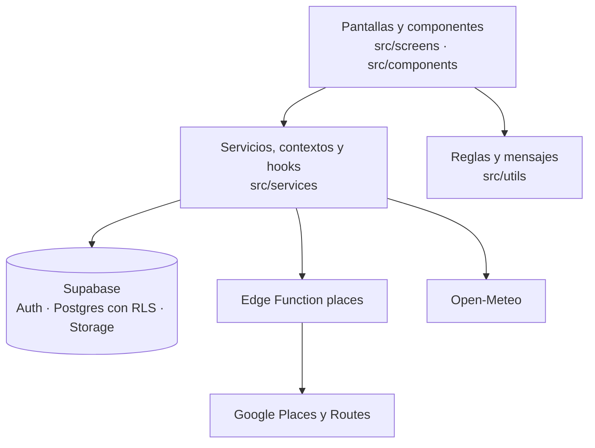

<a id="readme-top"></a>

<div align="center">
  

  <h1>PlanIt</h1>

  <p>
    <b>Outing planner based on location, weather and company.</b><br />
    <i>Planificador de salidas según la ubicación, el clima y la compañía.</i>
  </p>

  <p>
    
    
    
    
    
    <a href="https://github.com/MiloDS/Proyect_PlanIT/actions/workflows/ci.yml"></a>
  </p>

  <p>
    <a href="#english"><b>English</b></a> · <a href="#español"><b>Español</b></a>
  </p>
</div>

---

## English

PlanIt is a mobile app to discover places and organize outings based on location, weather and company. It is an academic project built with React Native and Expo.

**Contents:** [Features](#features) · [Getting started](#getting-started) · [Building the APK](#building-the-apk) · [Authors](#authors)

### Features

- 📍 **Nearby places**: map with nearby places, category filters and text search (Google Places), with photos, rating, hours and price for each place.
- 🌦️ **Weather-aware suggestions**: the home screen shows the current weather, and _Sorpréndeme_ ranks places by rating, weather and company.
- 🗓️ **Plan organizer**: visiting order, time at each place, travel times (Google Routes), estimated end time, budget per person and notes.
- 👥 **Shared plans**: members join with a code, by scanning a QR or through an email invitation. Only the creator changes the plan; guests suggest changes and the creator accepts or rejects them.
- ⭐ **Favorites**: saved places and plans.
- 🔔 **Reminders**: local notification before each plan, even with the app closed.
- 🌙 **Dark mode**: follows the system theme or the setting in Profile.
- 🔐 **Secure sign-in**: email or Google, with the session stored encrypted on the device.

### Tech stack

| Area            | Tools                                                                                           |
| --------------- | ----------------------------------------------------------------------------------------------- |
| App             | React Native 0.88, Expo SDK 58, TypeScript (strict), React Compiler                             |
| Navigation      | React Navigation (native stack and bottom tabs)                                                 |
| Backend         | Supabase: Auth (email and Google), Postgres with Row Level Security, Storage and Edge Functions |
| Maps and places | Google Places API (New), Routes API and Maps SDK for Android (`react-native-maps`)              |
| Weather         | Open-Meteo (free, no API key)                                                                   |
| Device features | expo-location, expo-notifications, expo-camera, expo-image-picker, expo-image, expo-secure-store |

### Project structure

```
PlanIt/
├── assets/                 # Logo, icons, splash screen and intro images
├── src/
│   ├── components/         # Reusable components
│   ├── navigation/         # React Navigation setup
│   ├── screens/            # App screens
│   ├── services/           # Supabase, Places, weather, plans and reminders; contexts and hooks
│   ├── styles/             # Light and dark palettes and global styles
│   ├── types/              # Shared types
│   └── utils/              # Supabase client, form rules, messages and helpers
├── supabase/               # Migrations, RLS tests and the `places` Edge Function
├── .env.example            # Environment variables template
├── app.json                # App configuration
├── app.config.ts           # Adds the Google Maps key when building
└── eas.json                # EAS Build profiles (preview = APK, simulator = iOS Simulator)
```

### Code organization

Each layer has a single responsibility:

- **Screens and components** (`src/screens`, `src/components`) display data and handle user input, without business rules.
- **Services, contexts and hooks** (`src/services`) communicate with Supabase, the `places` Edge Function and Open-Meteo.
- **Rules** (`src/utils/validation.ts`, `src/utils/recommendations.ts`) validate forms and rank the _Sorpréndeme_ results. The database enforces the critical rules again with RLS.
- **Messages** (`src/utils/messages.ts`) centralize every text shown to the user.


### Screens

| Screen                  | Description                                                                                          |
| ----------------------- | ---------------------------------------------------------------------------------------------------- |
| `IntroScreen`           | Welcome carousel, shown only on first launch                                                         |
| `LoginScreen`           | Sign-in with email and password or with Google                                                       |
| `RegisterScreen`        | Sign-up with name, email and password, or with Google                                                |
| `ForgotPasswordScreen`  | Password recovery with a code sent by email                                                          |
| `HomeScreen`            | Greeting, current weather, _Sorpréndeme_ shortcut and nearby places                                  |
| `SearchScreen`          | Map with nearby places, category filters, text search and "search this area"                         |
| `PlaceDetailScreen`     | Photo, rating, distance, hours, price and amenities; save, add to a plan or share                    |
| `SurpriseMeScreen`      | Preferences: activity, budget, distance and company                                                  |
| `RecommendationsScreen` | Places matching those preferences, ranked by rating, weather and company                             |
| `PlansScreen`           | Upcoming and past plans; joining a plan by code or QR                                                |
| `CreatePlanScreen`      | Plan organizer: places in order, time at each, transport, travel times, end time, budget and notes   |
| `PlanDetailScreen`      | Itinerary, members and the plan code or QR; the owner invites, edits and deletes, guests can leave   |
| `FavoritesScreen`       | Saved places and plans                                                                               |
| `ProfileScreen`         | Profile, settings (reminders, dark mode, help) and sign-out                                          |
| `EditProfileScreen`     | Name and profile photo                                                                               |
| `NotificationsScreen`   | Plan reminders on or off, and how long before they arrive                                            |
| `HelpScreen`            | Frequently asked questions                                                                           |

### Getting started

Requirements: Node.js, a [Supabase](https://supabase.com) project and a Google Cloud project with billing enabled.

1. **Install the dependencies**
   ```bash
   git clone https://github.com/MiloDS/Proyect_PlanIT.git
   cd Proyect_PlanIT
   npm install
   ```
2. **Configure Supabase**
   - Copy `.env.example` to `.env` and fill in the project URL and the **anon/publishable** key (never the `service_role` key).
   - Apply the migrations with `npx supabase link --project-ref <project-ref>` and `npx supabase db push --remote`, or run the files in `supabase/migrations/` in order in the SQL Editor. They also create the `avatars` bucket for profile photos.
   - **Google sign-in:** create a Google OAuth client of type _Web application_ with the redirect URI `https://<project-ref>.supabase.co/auth/v1/callback`, enable the Google provider in Supabase with its ID and secret, and add `exp://**` and `planit://**` under **Authentication → URL Configuration → Redirect URLs**.
   - **Password recovery:** in **Authentication → Emails → Templates → Reset Password**, show the code `{{ .Token }}` instead of the link. Supabase only sends emails to the project team unless a custom SMTP provider is configured.
3. **Configure Google Places**
   - In Google Cloud, enable **Places API (New)** and **Routes API** and create an API key restricted to those two APIs.
   - Store it in Supabase → **Edge Functions → Secrets** as `GOOGLE_PLACES_API_KEY` and deploy the function with `npx supabase functions deploy places`, keeping **Verify JWT** enabled. This key never ships inside the app.
4. **Run the app**
   ```bash
   npx expo start
   ```
   The project runs in Expo Go, where the map needs no extra key. After changing `.env`, restart with `npx expo start -c`.

### Database

Only the `place_id` of each Google place is stored, as Google's terms do not allow storing more. Every table has Row Level Security.

| Table            | Content                                           | Access                                                         |
| ---------------- | ------------------------------------------------- | -------------------------------------------------------------- |
| `profiles`       | Name and photo of each user                       | Read by any signed-in user; edited only by its owner           |
| `favorites`      | Saved places                                      | Owner only                                                     |
| `favorite_plans` | Saved plans                                       | Owner only, for plans they belong to                           |
| `plans`          | Title, date, transport, budget, notes and code    | Read by members; edited and deleted by the owner               |
| `plan_members`   | Members of each plan (`owner` / `member`)         | Read by members; the owner invites and removes; members can leave |
| `plan_places`    | Places of each plan, their order and time at each | Read by members; changed by the owner                          |
| `plan_suggestions` | Changes a guest proposes, with an optional message | Read by members; a guest suggests or withdraws; the owner answers |

Plans are created, edited and shared through database functions (`create_plan`, `update_plan`, `add_plan_place`, `join_plan_by_code`, `regenerate_plan_invite_code`, `add_plan_member_by_email`, `accept_plan_suggestion` and `reject_plan_suggestion`) that check permissions on the server. Profile photos are stored in the `avatars` bucket, where each user can only write to their own folder.

### Security

- Google sign-in uses **PKCE** with a SHA-256 challenge (`src/utils/webCrypto.ts` provides the crypto functions missing in Hermes).
- The session is stored **encrypted** with AES-256-GCM, with the key kept in the Android Keystore or the iOS Keychain (`src/utils/secureSessionStorage.ts`).
- The Places and Routes key stays in Supabase, and every database access goes through RLS.
- Android backups are disabled, and the APK only requests the permissions it uses.

### Building the APK

The APK is built in the cloud with [EAS Build](https://docs.expo.dev/build/introduction/), using the `preview` profile in `eas.json`.

1. **Maps key:** in Google Cloud, enable **Maps SDK for Android**, create an API key restricted to that API and add it to `.env` as `GOOGLE_MAPS_ANDROID_API_KEY`.
2. **Build:**
   ```bash
   npm install --global eas-cli
   eas login
   eas env:push preview --path .env
   eas build --platform android --profile preview
   ```
   `eas env:push` uploads the environment variables, since `.env` is not uploaded with the project. The build stops and names any missing variable. The EAS project in `app.json` (`owner` and `extra.eas.projectId`) belongs to the authors' Expo account; to build with a different account, remove both fields and run `eas init`.
3. **Install:** open the link or QR shown by EAS on an Android phone and allow installing apps from that source.
4. **Restrict the Maps key** to Android apps with the package `co.edu.pascualbravo.planit` and the SHA-1 fingerprint listed in expo.dev → **Credentials**.

The APK only includes ARM architectures (physical devices, not x86 emulators). R8 code shrinking is disabled (`enableMinifyInReleaseBuilds: false`) because it made the app crash on launch.

### iOS

The app is configured for iPhone: bundle identifier `co.edu.pascualbravo.planit`, portrait only, no iPad layout. On iOS the Search map is Apple Maps, so it needs no Maps key.

- **Expo Go:** run `npx expo start` and scan the QR code with the iPhone camera. No Apple account needed.
- **iOS Simulator (macOS):** `eas build --platform ios --profile simulator` builds for the Simulator without an Apple Developer account.
- **iPhone and App Store:** the `preview` (registered iPhones) and `production` (TestFlight and App Store) profiles require an Apple Developer Program membership. EAS asks for the account on the first build and creates the certificates.

Before publishing on the App Store, a second sign-in option such as Sign in with Apple must be added, because Apple requires one in apps that offer Google sign-in (App Review Guideline 4.8).

### Code quality

| Command             | Description                                                    |
| ------------------- | -------------------------------------------------------------- |
| `npm run lint`      | ESLint with the Expo rules                                     |
| `npm run format`    | Formats the code with Prettier (`format:check` only checks)    |
| `npm run typecheck` | TypeScript type check                                          |
| `npm run test:db`   | Runs the migrations on a local Postgres and tests the RLS rules |

GitHub Actions runs all four on every pull request and on every push to `develop` and `main`.

### Contributing

- **Branches:** `main` (stable), `develop` (integration), `feature/<name>` and `fix/<name>`. Pull requests target `develop`.
- **Commits:** `type(scope): message`, for example `feat(login): add Login screen with social buttons`.

### Project status

The main features are complete: authentication, places, favorites, shared plans with the organizer, reminders, dark mode and the Android APK. The iOS configuration is ready but has not been tested on an iPhone yet. Future work: notifications when someone is invited to a plan (push notifications) and more languages.

### Authors

<table>
  <tr>
    <td align="center" width="170">
      <a href="https://github.com/juanez-garcia"></a><br />
      <b>Juan Esteban García</b><br />
      <a href="https://github.com/juanez-garcia"><sub>juanez-garcia</sub></a>
    </td>
    <td align="center" width="170">
      <a href="https://github.com/jp-prog-26"></a><br />
      <b>Juan Pablo Orozco</b><br />
      <a href="https://github.com/jp-prog-26"><sub>jp-prog-26</sub></a>
    </td>
    <td align="center" width="170">
      <a href="https://github.com/MiloDS"></a><br />
      <b>Alexander Vargas Mejía</b><br />
      <a href="https://github.com/MiloDS"><sub>MiloDS</sub></a>
    </td>
  </tr>
</table>

<p>
  <a href="https://www.pascualbravo.edu.co"><b>Institución Universitaria Pascual Bravo</b></a><br />
  Software Development Technology program (<i>Tecnología en Desarrollo de Software</i>)<br />
  Course: Mobile Device Programming (<i>Programación de Dispositivos Móviles</i>)<br />
  Medellín, Colombia
</p>

---

## Español

PlanIt es una aplicación móvil para descubrir lugares y organizar salidas según la ubicación, el clima y la compañía. Es un proyecto académico desarrollado con React Native y Expo.

**Contenido:** [Funcionalidades](#funcionalidades) · [Primeros pasos](#primeros-pasos) · [Generar el APK](#generar-el-apk) · [Autores](#autores)

### Funcionalidades

- 📍 **Lugares cercanos**: mapa con lugares cercanos, filtros por categoría y búsqueda por texto (Google Places), con fotos, calificación, horario y precio de cada lugar.
- 🌦️ **Sugerencias según el clima**: la pantalla de inicio muestra el clima actual, y _Sorpréndeme_ ordena los lugares por calificación, clima y compañía.
- 🗓️ **Organizador de planes**: orden de visita, tiempo en cada lugar, traslados (Google Routes), hora de fin aproximada, presupuesto por persona y notas.
- 👥 **Planes compartidos**: los integrantes se unen con un código, escaneando un QR o por invitación al correo. Solo el creador modifica el plan; los invitados sugieren cambios y el creador los acepta o los rechaza.
- ⭐ **Favoritos**: lugares y planes guardados.
- 🔔 **Recordatorios**: notificación local antes de cada plan, incluso con la app cerrada.
- 🌙 **Modo oscuro**: sigue el tema del sistema o el ajuste de Perfil.
- 🔐 **Inicio de sesión seguro**: con correo o Google, y la sesión guardada cifrada en el dispositivo.

### Tecnologías

| Área                   | Herramientas                                                                                     |
| ---------------------- | ------------------------------------------------------------------------------------------------ |
| App                    | React Native 0.88, Expo SDK 58, TypeScript (estricto), React Compiler                            |
| Navegación             | React Navigation (native stack y bottom tabs)                                                    |
| Backend                | Supabase: Auth (correo y Google), Postgres con Row Level Security, Storage y Edge Functions      |
| Mapas y lugares        | Google Places API (New), Routes API y Maps SDK for Android (`react-native-maps`)                 |
| Clima                  | Open-Meteo (gratuito, sin API key)                                                               |
| Funciones del teléfono | expo-location, expo-notifications, expo-camera, expo-image-picker, expo-image, expo-secure-store |

### Estructura del proyecto

```
PlanIt/
├── assets/                 # Logo, íconos, pantalla de carga e imágenes de la intro
├── src/
│   ├── components/         # Componentes reutilizables
│   ├── navigation/         # Configuración de React Navigation
│   ├── screens/            # Pantallas de la app
│   ├── services/           # Supabase, Places, clima, planes y recordatorios; contextos y hooks
│   ├── styles/             # Paletas clara y oscura y estilos globales
│   ├── types/              # Tipos compartidos
│   └── utils/              # Cliente de Supabase, reglas de formularios, mensajes y utilidades
├── supabase/               # Migraciones, pruebas de RLS y la Edge Function `places`
├── .env.example            # Plantilla de variables de entorno
├── app.json                # Configuración de la app
├── app.config.ts           # Agrega la key de Google Maps al compilar
└── eas.json                # Perfiles de EAS Build (preview = APK, simulator = simulador de iOS)
```

### Organización del código

Cada capa tiene una sola responsabilidad:

- **Pantallas y componentes** (`src/screens`, `src/components`) muestran datos y atienden las acciones del usuario, sin reglas de negocio.
- **Servicios, contextos y hooks** (`src/services`) se comunican con Supabase, la Edge Function `places` y Open-Meteo.
- **Reglas** (`src/utils/validation.ts`, `src/utils/recommendations.ts`) validan los formularios y ordenan los resultados de _Sorpréndeme_. La base de datos vuelve a aplicar las reglas críticas con RLS.
- **Mensajes** (`src/utils/messages.ts`) centraliza todos los textos que se muestran al usuario.



### Pantallas

| Pantalla                | Descripción                                                                                                  |
| ----------------------- | ------------------------------------------------------------------------------------------------------------ |
| `IntroScreen`           | Carrusel de bienvenida, solo en el primer uso                                                                |
| `LoginScreen`           | Inicio de sesión con correo y contraseña o con Google                                                        |
| `RegisterScreen`        | Registro con nombre, correo y contraseña, o con Google                                                       |
| `ForgotPasswordScreen`  | Recuperación de contraseña con un código enviado al correo                                                   |
| `HomeScreen`            | Saludo, clima actual, acceso a _Sorpréndeme_ y lugares cercanos                                              |
| `SearchScreen`          | Mapa con lugares cercanos, filtros por categoría, búsqueda por texto y "Buscar en esta zona"                 |
| `PlaceDetailScreen`     | Foto, calificación, distancia, horario, precio y servicios; guardar, agregar a un plan o compartir           |
| `SurpriseMeScreen`      | Preferencias: actividad, presupuesto, distancia y compañía                                                   |
| `RecommendationsScreen` | Lugares que cumplen esas preferencias, ordenados por calificación, clima y compañía                          |
| `PlansScreen`           | Planes próximos y pasados; unión a un plan por código o QR                                                   |
| `CreatePlanScreen`      | Organizador: lugares en orden, tiempo en cada uno, transporte, traslados, hora de fin, presupuesto y notas    |
| `PlanDetailScreen`      | Itinerario, integrantes y el código o QR del plan; el creador invita, edita y elimina, los invitados pueden salir |
| `FavoritesScreen`       | Lugares y planes guardados                                                                                   |
| `ProfileScreen`         | Perfil, ajustes (recordatorios, modo oscuro, ayuda) y cierre de sesión                                       |
| `EditProfileScreen`     | Nombre y foto de perfil                                                                                      |
| `NotificationsScreen`   | Recordatorios de planes activados o no, y con cuánta anticipación llegan                                     |
| `HelpScreen`            | Preguntas frecuentes                                                                                         |

### Primeros pasos

Requisitos: Node.js, un proyecto de [Supabase](https://supabase.com) y un proyecto de Google Cloud con facturación activa.

1. **Instalar las dependencias**
   ```bash
   git clone https://github.com/MiloDS/Proyect_PlanIT.git
   cd Proyect_PlanIT
   npm install
   ```
2. **Configurar Supabase**
   - Copiar `.env.example` como `.env` y completar la URL del proyecto y la clave **anon/publishable** (nunca la `service_role`).
   - Aplicar las migraciones con `npx supabase link --project-ref <project-ref>` y `npx supabase db push --remote`, o ejecutar en orden los archivos de `supabase/migrations/` en el SQL Editor. También crean el bucket `avatars` para las fotos de perfil.
   - **Inicio con Google:** crear un cliente OAuth de Google de tipo _Aplicación web_ con la URI de redirección `https://<project-ref>.supabase.co/auth/v1/callback`, activar el proveedor de Google en Supabase con su ID y secreto, y agregar `exp://**` y `planit://**` en **Authentication → URL Configuration → Redirect URLs**.
   - **Recuperación de contraseña:** en **Authentication → Emails → Templates → Reset Password**, mostrar el código `{{ .Token }}` en lugar del enlace. Sin un proveedor SMTP propio, Supabase solo envía correos al equipo del proyecto.
3. **Configurar Google Places**
   - En Google Cloud, activar **Places API (New)** y **Routes API** y crear una API key restringida a esas dos APIs.
   - Guardarla en Supabase → **Edge Functions → Secrets** como `GOOGLE_PLACES_API_KEY` y desplegar la función con `npx supabase functions deploy places`, con **Verify JWT** activado. Esta key nunca se incluye en la app.
4. **Ejecutar la app**
   ```bash
   npx expo start
   ```
   El proyecto funciona en Expo Go, donde el mapa no necesita una key adicional. Después de cambiar el `.env`, reiniciar con `npx expo start -c`.

### Base de datos

De cada lugar de Google solo se guarda su `place_id`, porque los términos de Google no permiten guardar más. Todas las tablas tienen Row Level Security.

| Tabla            | Contenido                                              | Acceso                                                                   |
| ---------------- | ------------------------------------------------------ | ------------------------------------------------------------------------ |
| `profiles`       | Nombre y foto de cada usuario                          | Lectura para cualquier usuario con sesión; edición solo para su dueño    |
| `favorites`      | Lugares guardados                                      | Solo su dueño                                                            |
| `favorite_plans` | Planes guardados                                       | Solo su dueño, y solo de planes de los que hace parte                    |
| `plans`          | Título, fecha, transporte, presupuesto, notas y código | Lectura para los integrantes; el creador edita y elimina                 |
| `plan_members`   | Integrantes de cada plan (`owner` / `member`)          | Lectura para los integrantes; el creador invita y retira; los integrantes pueden salir |
| `plan_places`    | Lugares de cada plan, su orden y el tiempo en cada uno | Lectura para los integrantes; el creador los cambia                      |
| `plan_suggestions` | Cambios que propone un invitado, con un mensaje opcional | Lectura para los integrantes; un invitado sugiere o retira; el creador responde |

Los planes se crean, editan y comparten con funciones de la base de datos (`create_plan`, `update_plan`, `add_plan_place`, `join_plan_by_code`, `regenerate_plan_invite_code`, `add_plan_member_by_email`, `accept_plan_suggestion` y `reject_plan_suggestion`), que revisan los permisos en el servidor. Las fotos de perfil se guardan en el bucket `avatars`, donde cada usuario solo puede escribir en su propia carpeta.

### Seguridad

- El inicio de sesión con Google usa **PKCE** con un desafío SHA-256 (`src/utils/webCrypto.ts` aporta las funciones criptográficas que no trae Hermes).
- La sesión se guarda **cifrada** con AES-256-GCM, con la clave en el Keystore de Android o el Keychain de iOS (`src/utils/secureSessionStorage.ts`).
- La key de Places y Routes permanece en Supabase, y todo acceso a la base de datos pasa por RLS.
- Las copias de seguridad de Android están desactivadas, y el APK solo pide los permisos que usa.

### Generar el APK

El APK se compila en la nube con [EAS Build](https://docs.expo.dev/build/introduction/), con el perfil `preview` de `eas.json`.

1. **Key de Maps:** en Google Cloud, activar **Maps SDK for Android**, crear una API key restringida a esa API y agregarla al `.env` como `GOOGLE_MAPS_ANDROID_API_KEY`.
2. **Compilar:**
   ```bash
   npm install --global eas-cli
   eas login
   eas env:push preview --path .env
   eas build --platform android --profile preview
   ```
   `eas env:push` sube las variables de entorno, porque el `.env` no se sube con el proyecto. Si falta alguna, la compilación se detiene e indica cuál. El proyecto de EAS de `app.json` (`owner` y `extra.eas.projectId`) pertenece a la cuenta de Expo de los autores; para compilar con otra cuenta, eliminar ambos campos y ejecutar `eas init`.
3. **Instalar:** abrir en un teléfono Android el enlace o el QR que muestra EAS y permitir la instalación de apps de ese origen.
4. **Restringir la key de Maps** a apps Android con el paquete `co.edu.pascualbravo.planit` y la huella SHA-1 que aparece en expo.dev → **Credentials**.

El APK solo incluye las arquitecturas ARM (teléfonos físicos, no emuladores x86). La reducción de código con R8 está desactivada (`enableMinifyInReleaseBuilds: false`) porque hacía que la app se cerrara al abrirse.

### iOS

La app está configurada para iPhone: bundle identifier `co.edu.pascualbravo.planit`, solo vertical, sin diseño para iPad. En iOS el mapa de Buscar es Apple Maps, así que no necesita key de Maps.

- **Expo Go:** ejecutar `npx expo start` y escanear el QR con la cámara del iPhone. No hace falta cuenta de Apple.
- **Simulador de iOS (macOS):** `eas build --platform ios --profile simulator` compila para el simulador sin cuenta de Apple Developer.
- **iPhone y App Store:** los perfiles `preview` (iPhones registrados) y `production` (TestFlight y App Store) requieren una membresía del Apple Developer Program. EAS pide la cuenta en la primera compilación y crea los certificados.

Antes de publicar en la App Store hay que agregar una segunda opción de inicio de sesión, como Iniciar sesión con Apple, porque Apple la exige en las apps que ofrecen inicio de sesión con Google (App Review Guideline 4.8).

### Calidad del código

| Comando             | Descripción                                                             |
| ------------------- | ----------------------------------------------------------------------- |
| `npm run lint`      | ESLint con las reglas de Expo                                           |
| `npm run format`    | Formatea el código con Prettier (`format:check` solo revisa)            |
| `npm run typecheck` | Revisión de tipos de TypeScript                                         |
| `npm run test:db`   | Ejecuta las migraciones en un Postgres local y prueba las reglas de RLS |

GitHub Actions ejecuta los cuatro en cada pull request y en cada push a `develop` y `main`.

### Cómo contribuir

- **Ramas:** `main` (estable), `develop` (integración), `feature/<nombre>` y `fix/<nombre>`. Los pull requests van hacia `develop`.
- **Commits:** `tipo(alcance): mensaje`, por ejemplo `feat(login): add Login screen with social buttons`.

### Estado del proyecto

Las funciones principales están completas: autenticación, lugares, favoritos, planes compartidos con el organizador, recordatorios, modo oscuro y el APK para Android. La configuración para iOS está lista, pero aún no se ha probado en un iPhone. Trabajo futuro: notificaciones cuando alguien es invitado a un plan (notificaciones push) y más idiomas.

### Autores

<table>
  <tr>
    <td align="center" width="170">
      <a href="https://github.com/juanez-garcia"></a><br />
      <b>Juan Esteban García</b><br />
      <a href="https://github.com/juanez-garcia"><sub>juanez-garcia</sub></a>
    </td>
    <td align="center" width="170">
      <a href="https://github.com/jp-prog-26"></a><br />
      <b>Juan Pablo Orozco</b><br />
      <a href="https://github.com/jp-prog-26"><sub>jp-prog-26</sub></a>
    </td>
    <td align="center" width="170">
      <a href="https://github.com/MiloDS"></a><br />
      <b>Alexander Vargas Mejía</b><br />
      <a href="https://github.com/MiloDS"><sub>MiloDS</sub></a>
    </td>
  </tr>
</table>

<p>
  <a href="https://www.pascualbravo.edu.co"><b>Institución Universitaria Pascual Bravo</b></a><br />
  Tecnología en Desarrollo de Software<br />
  Curso: Programación de Dispositivos Móviles<br />
  Medellín, Colombia
</p>

---

<p align="center">
  <br />
  <sub>PlanIt · <a href="#readme-top">Back to top</a> · <a href="#readme-top">Volver arriba</a></sub>
</p>
